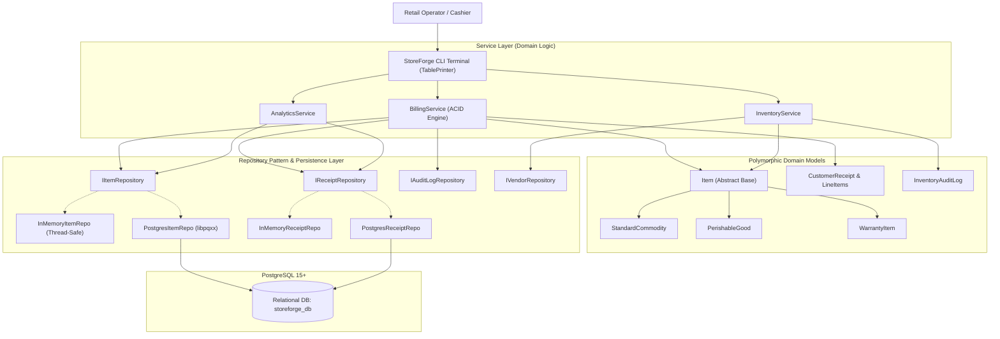
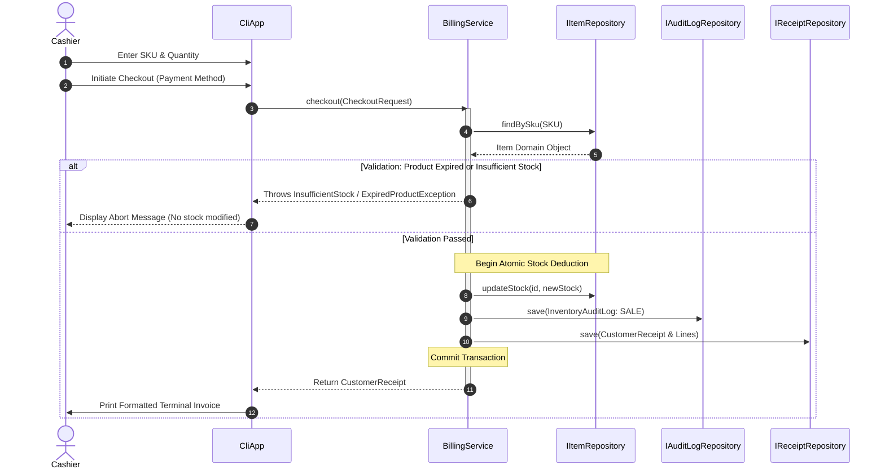
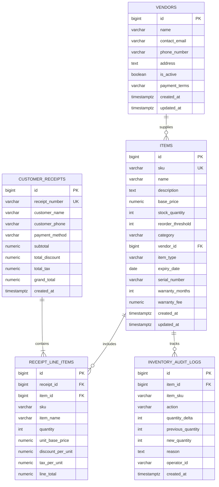

# StoreForge: Enterprise Retail Inventory & POS Billing System

[](https://github.com/akashch1013/InvenTrack-CPP/actions/workflows/ci.yml)
[](https://en.wikipedia.org/wiki/C%2B%2B17)
[](https://cmake.org)
[](https://github.com/jtv/libpqxx)
[](https://github.com/google/googletest)
[](LICENSE)

**StoreForge** is an enterprise-grade retail inventory management and Point-of-Sale (POS) billing engine developed in **modern C++17**. Engineered with Domain-Driven Design (DDD), strict ACID transactional integrity, and storage abstraction, StoreForge offers high-throughput in-memory execution for edge operations alongside production-ready persistence using **PostgreSQL** (`libpqxx`) with connection pooling and parameterized queries.

---

## Table of Contents

- [Key Technical Capabilities](#key-technical-capabilities)
- [System Architecture](#system-architecture)
  - [High-Level Component Flowchart](#high-level-component-flowchart)
  - [Atomic POS Checkout Sequence Diagram](#atomic-pos-checkout-sequence-diagram)
- [Database Architecture & ERD](#database-architecture--erd)
  - [Entity-Relationship Diagram](#entity-relationship-diagram)
  - [Analytical SQL Views & Reporting](#analytical-sql-views--reporting)
- [Object-Oriented Domain Architecture](#object-oriented-domain-architecture)
  - [Polymorphic Item Hierarchy](#polymorphic-item-hierarchy)
- [Repository Pattern & Storage Abstraction](#repository-pattern--storage-abstraction)
- [ACID Transactional Guarantees & Rollback](#acid-transactional-guarantees--rollback)
- [Build and Installation Guide](#build-and-installation-guide)
- [CLI Walkthrough & Demonstration](#cli-walkthrough--demonstration)
- [Test Suite (GoogleTest)](#test-suite-googletest)
- [Continuous Integration (CI)](#continuous-integration-ci)

---

## Key Technical Capabilities

1. **Modern C++17 Clean Architecture**:
   - Explicit RAII management, smart pointers (`std::unique_ptr`, `std::shared_ptr`), `std::optional`, and thread synchronization primitives (`std::shared_mutex`).
   - Strongly-typed identifier wrappers (e.g. `SKU`, `ItemId`, `VendorId`) to eliminate primitive obsession.
   - Comprehensive domain exception hierarchy (`InsufficientStockException`, `ExpiredProductException`, `TransactionException`).

2. **Polymorphic Retail Domain**:
   - `Item` abstract base class with polymorphic tax rules, tiered discount strategies, and serialization.
   - `StandardCommodity`: General retail merchandise with volume tier discounting.
   - `PerishableGood`: Dynamic markdown engine (clearance pricing based on days to expiration) and expired product lockouts.
   - `WarrantyItem`: Hardware serial number tracking, warranty period management, and protection fee calculations.

3. **Storage Abstraction (Repository Pattern)**:
   - Interface contracts: `IItemRepository`, `IVendorRepository`, `IReceiptRepository`, and `IAuditLogRepository`.
   - **In-Memory Store**: Thread-safe memory cache with snapshot rollback capabilities for low-latency testing and edge deployment.
   - **PostgreSQL Store**: Production-ready backend leveraging `libpqxx` with connection pooling, parameterized queries, and ACID transactions.

4. **ACID Transactional Billing Service**:
   - Atomically executes multi-item sales transactions.
   - Validates sellability, decrements inventory stock, writes immutable audit trails, and persists receipts.
   - **Guaranteed Rollback**: If any stock validation fails or an exception occurs, all inventory mutations are rolled back.

5. **Business Intelligence & Reporting**:
   - Real-time low-stock reorder alerts joined with vendor fulfillment contacts.
   - Daily and monthly revenue aggregations (gross sales, discounts granted, tax collected, basket averages).
   - Category performance ranking by revenue and unit volume.
   - Near-expiry clearance alerts.

---

## System Architecture

### High-Level Component Flowchart



### Atomic POS Checkout Sequence Diagram



---

## Database Architecture & ERD

### Entity-Relationship Diagram



### Analytical SQL Views & Reporting

StoreForge includes production SQL views in `sql/schema.sql`:

1. **Low Stock Reorder Alerts (`view_low_stock_reorder_alerts`)**:
   Joins low-stock items with vendor contact details, automatically computing suggested reorder quantities:
   ```sql
   SELECT sku, item_name, stock_quantity, reorder_threshold, suggested_reorder_quantity, vendor_name, vendor_email
   FROM view_low_stock_reorder_alerts;
   ```

2. **Daily Sales & Revenue Aggregation (`view_daily_sales_summary`)**:
   Rolls up sales volume, taxes, discounts, and average ticket size grouped by calendar date:
   ```sql
   SELECT sale_date, total_receipts, gross_subtotal, total_discount, total_tax, net_revenue, average_basket_value
   FROM view_daily_sales_summary;
   ```

3. **Category Performance Breakdown (`view_category_performance`)**:
   Aggregates line items by department to identify top revenue-generating retail categories:
   ```sql
   SELECT category, orders_count, total_units_sold, gross_sales, discounts_granted, net_revenue
   FROM view_category_performance;
   ```

4. **Perishable Expiry Watch List (`view_perishable_expiry_watch`)**:
   Monitors batches expiring within 7 days and classifies them into markdown tiers (25%, 50%, or expired).

---

## Object-Oriented Domain Architecture

### Polymorphic Item Hierarchy

```
                      +-----------------------------+
                      |         domain::Item        |  (Abstract Base)
                      +-----------------------------+
                      | + calculateTax()            |
                      | + calculateDiscount()       |
                      | + isSellable()              |
                      | + serializeJson()           |
                      | + clone()                   |
                      +--------------+--------------+
                                     |
         +---------------------------+---------------------------+
         |                                                       |
+------------------------------+                       +------------------------------+
|   StandardCommodity          |                       |       PerishableGood         |
+------------------------------+                       +------------------------------+
| - customTaxRate              |                       | - expirationDate             |
| + calculateDiscount(volume)  |                       | + getMarkdownPercentage()    |
| + calculateTax()             |                       | + isExpired()                |
+------------------------------+                       +------------------------------+
                                                               |
                                                       +------------------------------+
                                                       |         WarrantyItem         |
                                                       +------------------------------+
                                                       | - serialNumber               |
                                                       | - warrantyPeriodMonths       |
                                                       | - warrantyFee                |
                                                       | + calculateTax()             |
                                                       +------------------------------+
```

- **Dynamic Markdown Strategy**:
  - `daysUntilExpiration <= 0`: Unsellable (throws `ExpiredProductException`).
  - `daysUntilExpiration <= 2`: 50% discount automatically applied.
  - `daysUntilExpiration <= 5`: 25% discount applied.
  - `daysUntilExpiration <= 7`: 10% discount applied.
- **Volume Discounts**:
  - `quantity >= 10`: 10% bulk discount.
  - `quantity >= 5`: 5% bulk discount.
- **Electronics & Warranty**:
  - Enforces mandatory unique serial numbers and applies protection fee surcharges.

---

## Repository Pattern & Storage Abstraction

The storage layer strictly decouples business services from database implementations:

- **`storeforge::repo::IItemRepository`**: Contract for CRUD, category queries, and low-stock filters.
- **`storeforge::repo::IVendorRepository`**: Manages vendor directory.
- **`storeforge::repo::IReceiptRepository`**: Persists customer receipts and date-range lookups.
- **`storeforge::repo::IAuditLogRepository`**: Appends immutable inventory logs.

### Dual Backends:
1. **`InMemoryRepositories`**:
   - Zero-dependency execution using `std::shared_mutex` for read-heavy concurrency.
   - Provides snapshot memory rollback for transactional testing.
2. **`PostgresRepositories`**:
   - Production backend with `storeforge::db::ConnectionPool`.
   - Uses `pqxx::work` with parameterized SQL (`$1, $2, ...`) guarding against SQL injection.

---

## ACID Transactional Guarantees & Rollback

The `BillingService::checkout()` process guarantees **Atomicity**, **Consistency**, **Isolation**, and **Durability**:

```cpp
try {
    // 1. Validate all cart items and stock levels
    for (const auto& item : cart) {
        if (!item->isSellable() || item->getStock() < requested) {
            throw InsufficientStockException(...);
        }
    }

    // 2. Decrement stock & record audit logs
    for (const auto& item : cart) {
        repo.updateStock(item->getId(), newStock);
        auditRepo.save(InventoryAuditLog(...));
    }

    // 3. Persist Receipt
    receiptRepo.save(receipt);

} catch (const std::exception& e) {
    // Compensating rollback: Reverts all modified stock to original state
    rollbackModifiedStock();
    throw TransactionException("Checkout failed and changes were rolled back");
}
```

---

## Build and Installation Guide

### Prerequisites
- C++17 compliant compiler (`g++-11+`, `clang++-14+`, or MSVC 2019+)
- CMake 3.16 or newer
- (Optional) PostgreSQL 13+ & `libpqxx` (for PostgreSQL persistence)
- GoogleTest (automatically downloaded via `FetchContent` if not found locally)

### Build Steps

```bash
# Clone the repository
git clone https://github.com/akashch1013/InvenTrack-CPP.git
cd InvenTrack-CPP

# Configure CMake
cmake -B build -S . \
  -DCMAKE_BUILD_TYPE=Release \
  -DSTOREFORGE_BUILD_TESTS=ON \
  -DSTOREFORGE_ENABLE_POSTGRES=ON

# Compile the library, CLI, and test suite
cmake --build build --config Release -j$(nproc)
```

### PostgreSQL Setup (Optional)

```bash
# Create database
psql -U postgres -c "CREATE DATABASE storeforge_db;"

# Apply schema DDL and seed dataset
psql -U postgres -d storeforge_db -f sql/schema.sql
psql -U postgres -d storeforge_db -f sql/seed.sql
```

---

## CLI Walkthrough & Demonstration

Run the interactive POS terminal:
```bash
./build/storeforge_cli
```

### Main Operational Menu
```text
=======================================================================
   STOREFORGE  -  Enterprise Retail Inventory & POS Billing System   
               Modern C++17 Architecture with PostgreSQL Backend       
=======================================================================

--- Main Operational Menu ---
  1. Inventory Catalog & Stock Overview
  2. POS Billing & Customer Checkout
  3. Stock Replenishment (Restock)
  4. Stock Write-Off (Damage / Spoilage)
  5. Vendor Directory
  6. Analytics & Intelligence Reports
  7. Inventory Audit Trail
  8. Exit System

Enter selection [1-8]: 1
```

### Formatted Inventory Catalog
```text
+----+------------+--------------------------+------------+----------------+------------+--------+--------------+
| ID |    SKU     |       Product Name       |    Type    |    Category    | Base Price |  Stock |    Status    |
+====+============+==========================+============+================+============+========+==============+
|  1 | COMM-PAP-01| Multi-purpose Copy Paper |   STANDARD | General        |      $7.99 |    120 |     IN STOCK |
|  3 | PERI-MLK-01| Organic Whole Milk 1 Gal | PERISHABLE | Grocery        |      $4.99 |     18 |     IN STOCK |
|  5 | PERI-BRD-03| Artisan Sourdough Loaf   | PERISHABLE | Grocery        |      $3.89 |      4 |    LOW STOCK |
|  6 | ELEC-LPT-01| ForgePro 15-inch Laptop  |   WARRANTY | Electronics    |   $1199.99 |      8 |     IN STOCK |
+----+------------+--------------------------+------------+----------------+------------+--------+--------------+
```

### POS Invoice Output
```text
=======================================================================
                     CUSTOMER INVOICE & RECEIPT                       
=======================================================================
  Receipt Number: REC-20261124-4821
  Customer Name : Alice Johnson
  Payment Method: CREDIT_CARD
  Timestamp     : 2026-11-24 15:30:00
-----------------------------------------------------------------------
+------------+--------------------------+-----+------------+------------+------------+------------+
|    SKU     |        Item Name         | Qty | Unit Price |  Discount  |    Tax     |   Total    |
+============+==========================+=====+============+============+============+============+
| ELEC-LPT-01| ForgePro 15-inch Laptop  |   1 |   $1199.99 |      $0.00 |    $149.99 |   $1349.98 |
| PERI-MLK-01| Organic Whole Milk 1 Gal |   2 |      $4.99 |      $5.00 |      $0.20 |      $5.18 |
+------------+--------------------------+-----+------------+------------+------------+------------+
-----------------------------------------------------------------------
  Subtotal (Gross)  : $1209.97
  Total Discounts   : -$5.00
  Total Tax (VAT)   : $150.19
  GRAND TOTAL DUE   : $1355.16
=======================================================================
       Thank you for choosing StoreForge Retail Systems!              
=======================================================================
```

---

## Test Suite (GoogleTest)

Execute the comprehensive unit and integration test suite via `ctest`:

```bash
ctest --test-dir build --output-on-failure --verbose
```

### Covered Test Scenarios:
- **`DomainTests`**: Polymorphic discounting, dynamic markdown clearance rules, warranty fee calculations, serial validation, JSON serialization.
- **`InMemoryRepoTests`**: Thread-safe concurrent reads/writes, unique SKU constraints, snapshot rollback verification.
- **`BillingServiceTests`**: Atomic checkout execution, out-of-stock rollback verification (ensuring stock is left unmodified upon transaction abort), expired perishable rejection.
- **`AnalyticsServiceTests`**: Reorder alerts generation, daily financial aggregations, and category performance ranking.

---

## Continuous Integration (CI)

StoreForge includes an automated GitHub Actions CI pipeline (`.github/workflows/ci.yml`):
- **Build Matrix**: Compiles against GCC 11 and Clang 14 on Ubuntu 22.04.
- **Service Container**: Spins up a PostgreSQL 15 container, applies `schema.sql`, and loads `seed.sql`.
- **Validation**: Executes all GoogleTest suites and smoke-tests the CLI executable.
