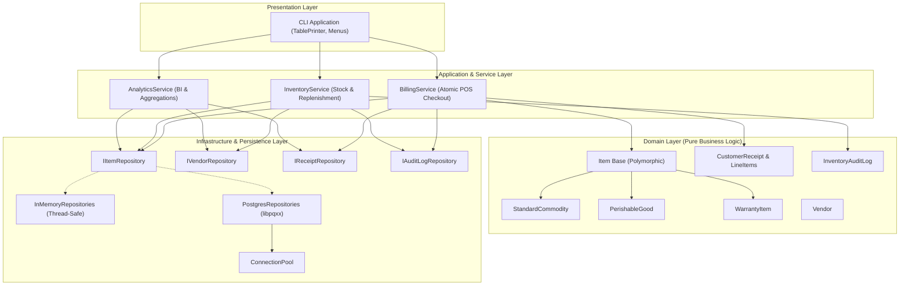

# StoreForge Architecture & Design Specification

## 1. Architectural Philosophy

StoreForge is built using **Domain-Driven Design (DDD)** and **Clean Layered Architecture** in modern C++17. The design strictly isolates business domain logic from infrastructure details such as SQL databases, file systems, or terminal presentation.

---

## 2. Design Patterns Applied

### 2.1 Repository Pattern & Storage Abstraction
The business layer never issues raw SQL queries directly. Instead, all data operations are mediated through abstract interface contracts:
- `IItemRepository`
- `IVendorRepository`
- `IReceiptRepository`
- `IAuditLogRepository`

This decouples the business logic, enabling:
- High-speed, in-memory execution for unit testing and offline edge deployments.
- Enterprise-scale persistent storage powered by PostgreSQL.

### 2.2 Polymorphic Strategy Pattern (Domain Objects)
Items exhibit polymorphic behaviors based on their business category:
- **Tax Rules**: Perishables and grocery staples utilize reduced tax brackets, standard commodities use baseline VAT, and electronics items assess additional warranty protection fees.
- **Discount Rules**: Standard commodities evaluate volume bulk-buy breaks, while perishables calculate dynamic time-decay markdown tiers.

### 2.3 RAII & Resource Management
- **Connection Pool Leasing**: Acquired PostgreSQL connections are wrapped in `std::shared_ptr<pqxx::connection>` with custom deleters that automatically return idle connections to the pool upon going out of scope.
- **Smart Pointers**: Complete avoidance of raw owning pointers; domain items are managed via `std::unique_ptr<Item>` and deep-cloning primitives (`clone()`).

### 2.4 Transactional Rollback & Compensation
The POS billing engine enforces atomic all-or-nothing checkouts. If any line item cannot be fulfilled (due to concurrent depletion or unexpected failure), a compensation mechanism restores previously decremented stock counts to their exact prior levels, ensuring zero database drift.

---

## 3. Concurrency Model

- **Read-Write Locking**: In-memory stores utilize `std::shared_mutex` with `std::shared_lock` for concurrent readers and `std::unique_lock` for mutating writes.
- **Connection Pooling**: PostgreSQL connections are queued thread-safely with `std::condition_variable` timeouts, preventing thread starvation under high concurrency.
