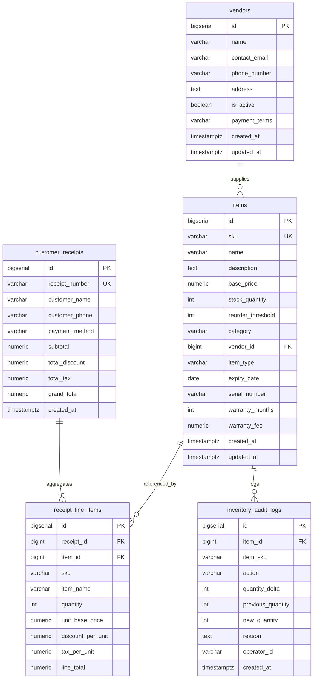

# StoreForge Database Specification & Analytical Views

## 1. Schema Overview

StoreForge features a **Third Normal Form (3NF)** relational database schema designed for PostgreSQL 13+ and accessed via `libpqxx`.



---

## 2. Table Specifications

### 2.1 `vendors`
Stores upstream product suppliers and wholesale distributors.
- `id`: Auto-incrementing primary key.
- `name`: Non-empty legal trading name (`CHECK (LENGTH(TRIM(name)) > 0)`).
- `contact_email`: Verified via regex constraint (`CHECK (contact_email ~* '^[A-Za-z0-9._%+-]+@[A-Za-z0-9.-]+\.[A-Za-z]{2,}$')`).
- `payment_terms`: Invoicing terms (e.g. `Net 15`, `Net 30`, `Net 45`).

### 2.2 `items`
Stores all retail merchandise with single-table inheritance polymorphism:
- `item_type`: Restricted to `STANDARD`, `PERISHABLE`, or `WARRANTY`.
- `expiry_date`: Required when `item_type = 'PERISHABLE'`.
- `serial_number`: Required when `item_type = 'WARRANTY'`.
- `stock_quantity`: Strictly non-negative (`CHECK (stock_quantity >= 0)`).
- `reorder_threshold`: Minimum safe inventory level triggering reorder warnings.

### 2.3 `customer_receipts`
Records finalized POS sales transactions:
- `receipt_number`: Unique alphanumeric invoice code (e.g. `REC-20261124-4821`).
- `payment_method`: Constrained to `CASH`, `CREDIT_CARD`, `DEBIT_CARD`, `UPI_DIGITAL`, `STORE_CREDIT`.
- Totals: `subtotal`, `total_discount`, `total_tax`, `grand_total`.

### 2.4 `receipt_line_items`
Detailed line-item breakdown of products per receipt:
- Enforces relational integrity (`ON DELETE CASCADE` from receipt, `ON DELETE RESTRICT` from items).
- Tracks unit pricing, per-unit tax, and promotional discounts at the moment of checkout.

### 2.5 `inventory_audit_logs`
Append-only historical ledger tracking every stock mutation:
- Actions: `RESTOCK`, `SALE`, `RETURN`, `WRITE_OFF`, `ADJUSTMENT`.
- Stores `previous_quantity`, `quantity_delta`, and `new_quantity` for forensic auditability.

---

## 3. Analytical Views & Reports

StoreForge includes 4 pre-built analytical views located in `sql/schema.sql`:

### 3.1 Low Stock Reorder Alerts (`view_low_stock_reorder_alerts`)
Identifies items requiring immediate inventory replenishment:
```sql
SELECT 
    i.id AS item_id,
    i.sku,
    i.name AS item_name,
    i.category,
    i.stock_quantity,
    i.reorder_threshold,
    GREATEST(20, i.reorder_threshold * 3) AS suggested_reorder_quantity,
    v.id AS vendor_id,
    COALESCE(v.name, 'Unassigned') AS vendor_name,
    COALESCE(v.contact_email, 'N/A') AS vendor_email
FROM items i
LEFT JOIN vendors v ON i.vendor_id = v.id
WHERE i.stock_quantity <= i.reorder_threshold
ORDER BY i.stock_quantity ASC;
```

### 3.2 Daily Sales & Financial Aggregation (`view_daily_sales_summary`)
Generates daily accounting rollups of gross revenue, discounts, VAT collected, and average basket sizes:
```sql
SELECT 
    DATE(created_at) AS sale_date,
    COUNT(id) AS total_receipts,
    SUM(subtotal) AS gross_subtotal,
    SUM(total_discount) AS total_discount,
    SUM(total_tax) AS total_tax,
    SUM(grand_total) AS net_revenue,
    ROUND(AVG(grand_total), 2) AS average_basket_value
FROM customer_receipts
GROUP BY DATE(created_at)
ORDER BY sale_date DESC;
```

### 3.3 Category Sales Performance (`view_category_performance`)
Ranks retail departments by revenue volume and margins:
```sql
SELECT 
    i.category,
    COUNT(DISTINCT rli.receipt_id) AS orders_count,
    SUM(rli.quantity) AS total_units_sold,
    SUM(rli.unit_base_price * rli.quantity) AS gross_sales,
    SUM(rli.discount_per_unit * rli.quantity) AS discounts_granted,
    SUM(rli.tax_per_unit * rli.quantity) AS taxes_collected,
    SUM(rli.line_total) AS net_revenue
FROM receipt_line_items rli
JOIN items i ON rli.item_id = i.id
GROUP BY i.category
ORDER BY net_revenue DESC;
```

### 3.4 Perishable Expiry Watch List (`view_perishable_expiry_watch`)
Classifies perishable grocery goods into markdown clearance tiers:
```sql
SELECT 
    i.id AS item_id,
    i.sku,
    i.name,
    i.stock_quantity,
    i.expiry_date,
    (i.expiry_date - CURRENT_DATE) AS days_remaining,
    CASE 
        WHEN i.expiry_date < CURRENT_DATE THEN 'EXPIRED'
        WHEN (i.expiry_date - CURRENT_DATE) <= 2 THEN 'CRITICAL (50% Markdown)'
        WHEN (i.expiry_date - CURRENT_DATE) <= 5 THEN 'NEAR EXPIRY (25% Markdown)'
        ELSE 'NORMAL'
    END AS markdown_tier
FROM items i
WHERE i.item_type = 'PERISHABLE'
  AND (i.expiry_date <= CURRENT_DATE + INTERVAL '7 days')
ORDER BY i.expiry_date ASC;
```
